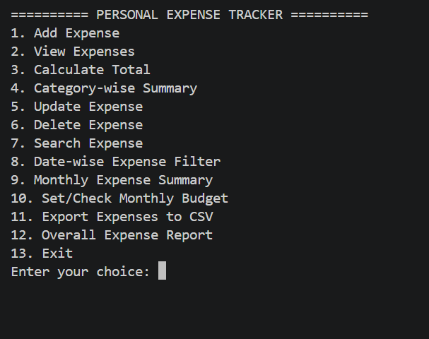
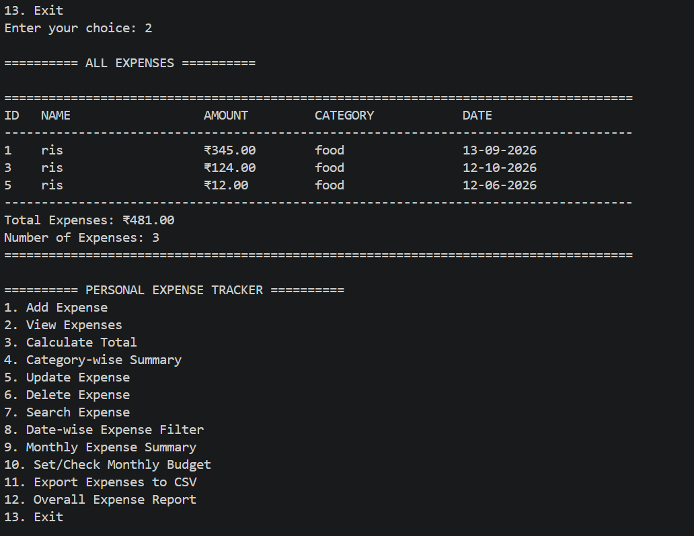
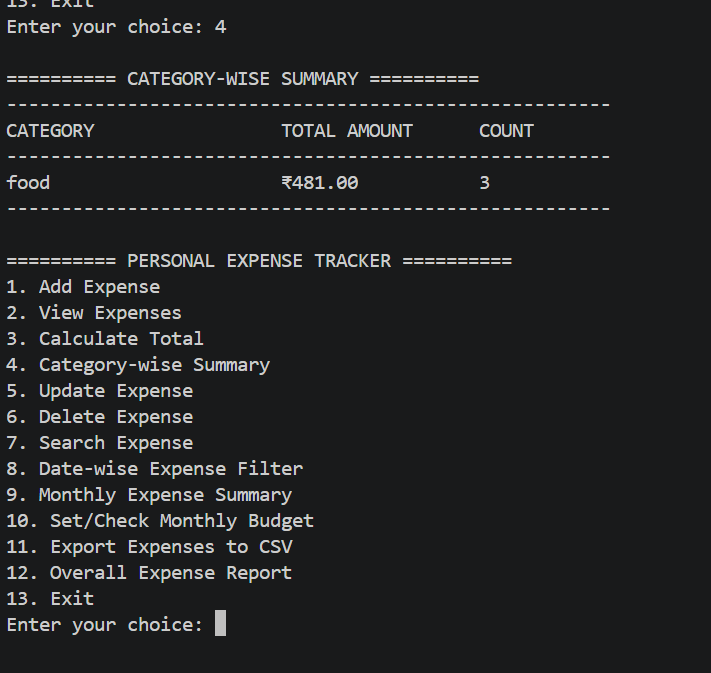
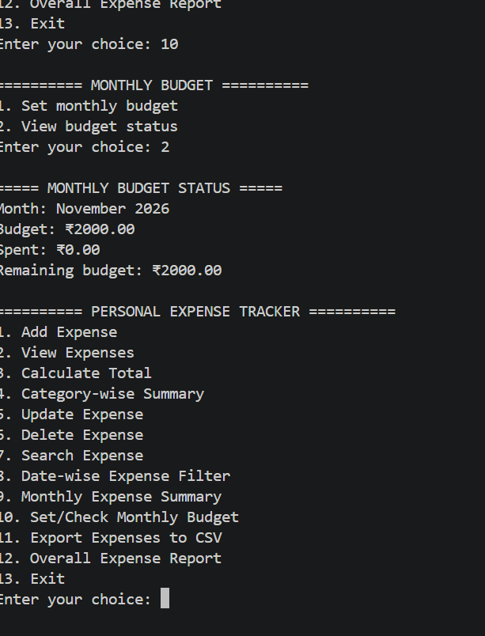
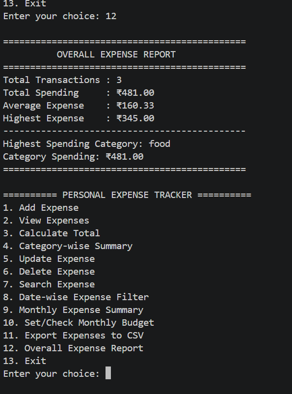

# Personal Expense Tracker

## Project Description
The Personal Expense Tracker is a beginner-level Python application developed to manage and track daily expenses. It allows users to record expenses, monitor spending, manage monthly budgets and generate expense reports.

## Features

1. Add new expenses.
2. View all recorded expenses.
3. Calculate total expenses.
4. Generate category-wise summaries.
5. Update existing expenses.
6. Delete expenses.
7. Search expenses by name or category.
8. Filter expenses by date or date range.
9. Generate monthly expense summaries.
10. Set monthly budgets and receive budget warnings.
11. Export expense records to CSV.
12. Generate overall expense reports.

## Technologies Used

- Python
- SQLite Database
- CSV File Handling
- datetime module
- re module

## Database

SQLite is used to store expense records permanently. Each expense contains:

- Expense ID
- Expense Name
- Amount
- Category
- Date

## How to Run

1. Install Python on your computer.
2. Open the project folder in VS Code.
3. Open the terminal.
4. Run the following command:

```bash
python expense_tracker.py
```

5. Select an option from the menu to manage your expenses.

## Project Learning Outcomes

- Understanding Python functions and control structures.
- Implementing input validation and exception handling.
- Performing CRUD operations.
- Working with SQLite databases and SQL queries.
- Handling dates and CSV files.
- Generating summaries and expense reports.

## Project Type
Beginner-Level Python Mini Project

## Project Screenshots

### 1. Main Menu


### 2. View Expenses


### 3. Category-wise Summary


### 4. Monthly Budget Report


### 5. Overall Expense Report

